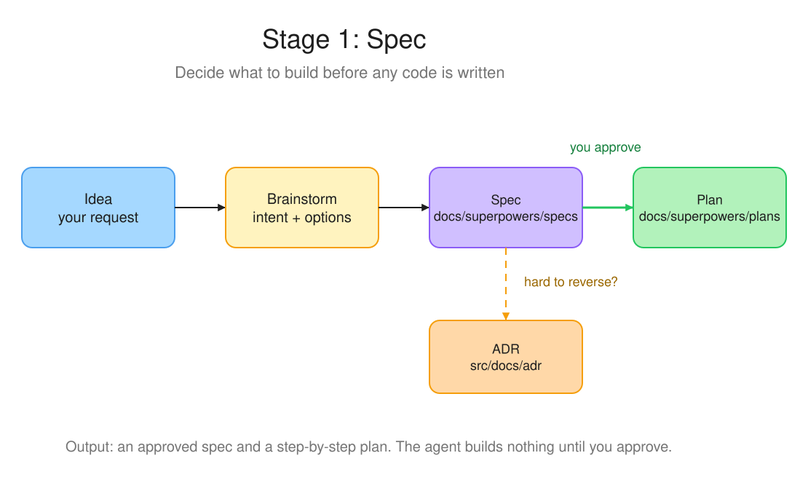
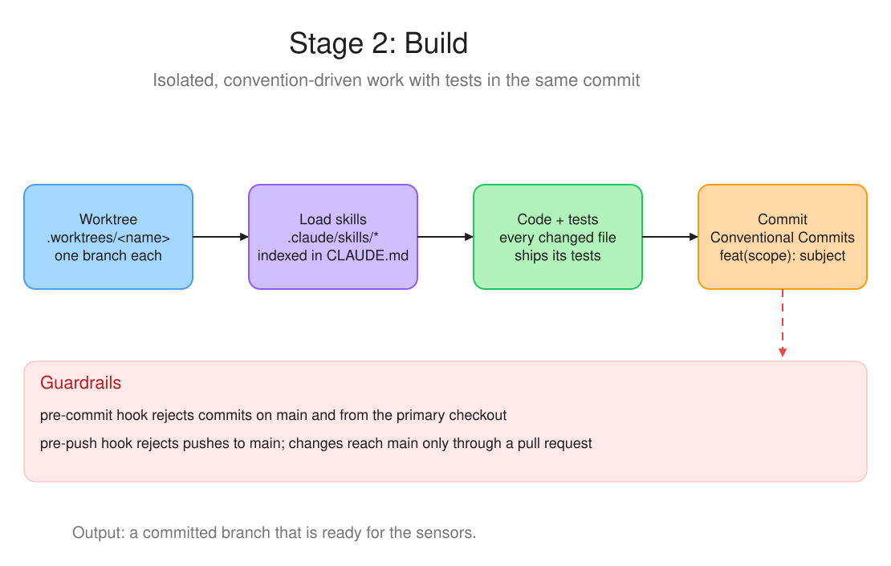
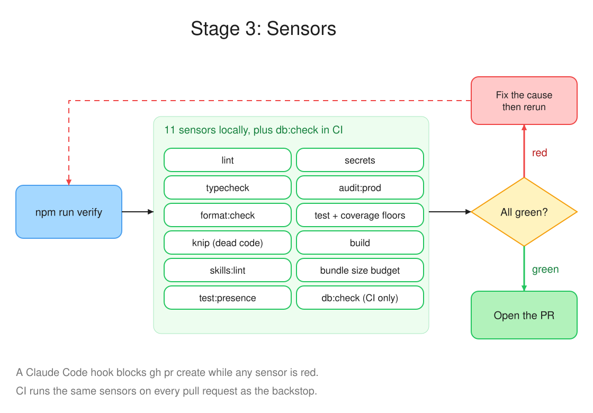

# FutMeet

FutMeet helps casual football players organize pickup games. One person opens a room and shares the link, players join a waiting room, and when the game starts FutMeet sorts everyone into balanced teams, keeping priority players in the game first.

1. **Create a room** and share its link
2. **Join the waiting room** and add players
3. **Start the game** and mark priority players
4. **Sort into teams** and see the results

## Monorepo layout

TypeScript monorepo on npm workspaces, orchestrated by Turbo.

| Path | What it is |
|---|---|
| `apps/api` | Fastify 5 REST API on PostgreSQL 16 (`room` and `game` modules) |
| `apps/web` | React 19 + Vite single-page app |
| `packages/shared` | Domain types and utils shared by both apps (`@futmeet/shared`) |
| `packages/sensors` | The quality checks behind `npm run verify` (see below) |
| `packages/tsconfig`, `packages/oxlint-config` | Shared TypeScript and oxlint configuration |

**Stack**: Zustand, React Hook Form + Zod, React Router 7, CSS Modules, Lucide icons, Knex migrations with a raw `pg` pool at runtime, Vitest, oxlint, GitHub Actions.

## Getting started

Requires Node 26 (`nvm use`, see `.nvmrc`), npm and Docker for the database.

```bash
npm install
cp apps/api/.env.example apps/api/.env
npm run db:up -w @futmeet/api
npm run db:migrate -w @futmeet/api
npm run dev:api    # http://localhost:3001
npm run dev:web    # http://localhost:5173
```

| Script | Description |
|---|---|
| `npm run dev:api` / `dev:web` | Start one app with hot reload |
| `npm run lint` | oxlint across all packages (warnings are errors) |
| `npm run typecheck` | `tsc --noEmit` across all packages |
| `npm run test` | Vitest with coverage floors |
| `npm run build` | Build every package in dependency order |
| `npm run verify` | Run every sensor; the gate before a pull request |
| `npm run format` | Format the files you changed with Prettier |

## How AI works on this project

AI agents write most changes here, and three stages keep that work predictable: **Spec** decides what to build, **Build** produces it in isolation, and **Sensors** prove it is safe to merge. Each stage has written rules the agent loads on demand, so the process lives in the repository and not in anyone's head.

### 1. Spec



Before any code, the idea is explored and written down:

- The agent clarifies intent and compares approaches before touching code
- The result is a spec in `docs/superpowers/specs/` and a step-by-step plan in `docs/superpowers/plans/`
- A decision that is hard to reverse also gets an ADR in `src/docs/adr/` (`adr-on-branch` skill)

### 2. Build



Work happens in an isolated git worktree on its own branch, never on `main` (`worktree-workflow` skill):

- `git worktree add .worktrees/<type>-<name> -b <type>/<name>`; the pre-commit hook rejects commits from the primary checkout and from `main`
- Project conventions live in `.claude/skills/`: short `SKILL.md` files (100 lines or fewer) that point to `references/` for detail. `CLAUDE.md` holds the index, so the agent loads only the skill that matches the task
- Every changed file ships with its tests in the same commit (`testing-vitest` skill)
- Commits, branches and PR titles follow Conventional Commits (`git-conventional-commits` skill)

### 3. Sensors



A sensor is an automated check that reads green or red. `npm run verify` runs all of them, and a pull request opens only when every one is green (`pr-gate` skill). A red sensor is fixed at its cause and rerun; skipping tests, lowering a threshold or silencing a rule does not count.

| Sensor | Catches |
|---|---|
| `lint`, `typecheck` | oxlint warnings, type errors |
| `format:check` | Changed files that do not match Prettier |
| `knip` | Unused files, dependencies and binaries |
| `skills:lint` | Skills over 100 lines, bad frontmatter, broken `references/` links, skills missing from the `CLAUDE.md` index |
| `test:presence` | A changed source file without a test, a changed web component without an a11y test |
| `secrets` | Credentials committed to the repo |
| `audit:prod` | High or critical vulnerabilities in production dependencies |
| `test` | Failing tests, coverage under the floor in each `vitest.config` |
| `build`, `bundle` | Compile errors, web bundle over the gzip budget in `packages/sensors/bundle-budget.json` |
| `db:check` | Migrations that fail to apply or roll back (`VERIFY_DB=1` locally, always in CI) |

Enforcement has three layers: a Claude Code hook in `.claude/settings.json` blocks `gh pr create` while any sensor is red, git hooks in `.githooks/` block commits to `main` and from the primary checkout, and CI runs the same sensors on every pull request.

### Diagrams and MCP setup

The diagrams are drawn with the [Excalidraw MCP](https://mcp.excalidraw.com). `docs/ai-workflow/*.elements.json` holds each diagram's element list: paste one into the MCP's `create_view` tool to redraw or edit it, then update the matching `.svg`, which is what this README embeds. `.mcp.json` is gitignored because it can reference tokens, so each clone adds the entry itself:

```json
{
  "excalidraw": { "type": "http", "url": "https://mcp.excalidraw.com" }
}
```

Then run `/mcp` in Claude Code and sign in once. `.claude/settings.json` already lists `excalidraw` under `enabledMcpjsonServers`.

## CI/CD

GitHub Actions runs on every pull request and on pushes to `main`: Lint, Typecheck, Test, Sensors, Migrations (against a Postgres service), then Build with the bundle budget. All checks must pass before merging.

## Documentation

- `CLAUDE.md`: required workflow, skill index and conventions the agent follows
- `.claude/skills/`: one folder per skill, details in `references/`
- `docs/superpowers/`: specs and plans produced by the Spec stage
- `src/docs/adr/`, `docs/adr/`, `adr/`: architecture decision records
- `docs/database-model.html`, `docs/SECURITY_ASSESSMENT.md`: database model and security assessment

## License

Private project
